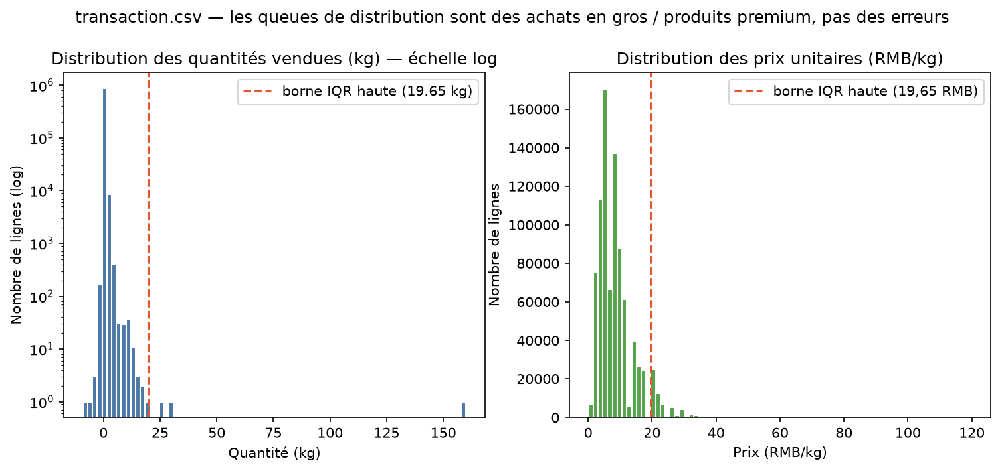
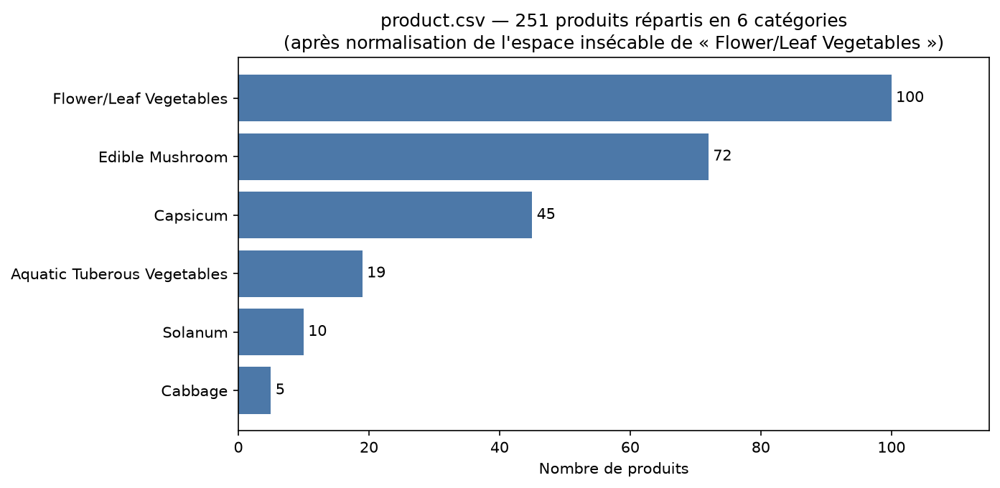
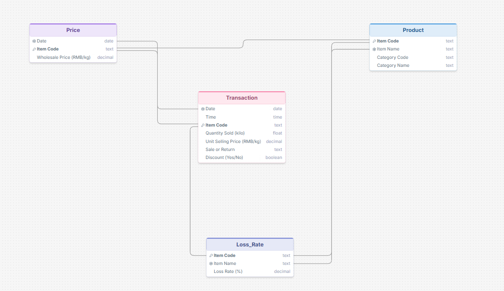

# Projet Data Viz — Pipeline des ventes de produits frais

> Exercice 2 du cours Data Analytics — préparation collaborative des données
> (`transaction.csv`, `product.csv`, `price.csv`, `loss_rate.csv`) avant le
> dashboard Comex (Exercice 3).

## Contexte métier (issu de l'Exercice 1)

Le Comex estime que **les ventes de produits frais sous-performent sur
certaines catégories** et veut un livrable clair « pour demain matin » pour
savoir où agir.

- **Why** : identifier ce qui bloque la performance des produits frais.
- **Who** : le Comex (décideurs), via le Directeur Merchandising.
- **What** : KPI de CA, marge brute, volume vendu, évolution N-1.
- **When / Where** : période **juin 2022 → juin 2023** (12 derniers mois),
  toutes catégories, données de 4 fichiers CSV issus du système de caisse et
  du référentiel produits.

## L'équipe et la spécialisation des rôles (Étape 1)

Chaque fichier CSV a un seul responsable — une seule personne ne peut pas
écraser le travail d'un autre :

| Membre | Fichier en charge | Branche Git dédiée |
|---|---|---|
| Lucas | `transaction.csv` | `feature/clean-transaction` |
| Lucas | `product.csv` | `feature/clean-product` |
| _[à compléter]_ | `price.csv` | `feature/clean-price` |
| _[à compléter]_ | `loss_rate.csv` | `feature/clean-loss-rate` |

👉 Le responsable de `price.csv` / `loss_rate.csv` trouve les attentes exactes
(noms de fichiers, colonnes) dans le **contrat d'équipe** :
[docs/etape2_modele_donnees.md, section 4](docs/etape2_modele_donnees.md),
et le mode d'emploi Git dans [docs/recap_guide_branches.md](docs/recap_guide_branches.md).

## Structure du repo

```
├── README.md                        ← ce fichier (rendu : étapes 1 à 3)
├── data/
│   ├── raw/                         ← CSV bruts, IGNORÉS par Git (~52 Mo)
│   └── clean/                       ← sorties nettoyées, ignorées aussi
├── docs/
│   ├── etape1_diagnostic_transaction.md
│   ├── etape1_diagnostic_product.md
│   ├── etape2_modele_donnees.md     ← modèle relationnel + schéma en étoile
│   └── img/                         ← captures et graphiques du README
└── scripts/
    ├── etape1_diagnostic_transaction.py
    ├── etape1_diagnostic_product.py
    ├── etape2_star_schema.py        ← génère l'image du schéma en étoile
    ├── etape3_clean_transaction.py  ← nettoyage transaction.csv
    ├── etape3_clean_product.py     ← nettoyage product.csv
    └── etape3_consolidate.py       ← assemblage du schéma en étoile
```

**Où sont les CSV ?** Ils ne sont **pas** dans le repo (trop volumineux pour
Git, et la donnée brute n'est pas du code). Chaque membre pose ses fichiers
dans `data/raw/` en local. Le pipeline est rejouable avec `python scripts/...`.

## Étape 1 — Diagnostic & spécialisation des rôles

Chaque responsable inspecte sa table et liste explicitement ce qui doit être
changé/nettoyé, **justifié par une logique métier** (règle d'or du cours).

- Diagnostic `transaction.csv` → [docs/etape1_diagnostic_transaction.md](docs/etape1_diagnostic_transaction.md)
- Diagnostic `product.csv` → [docs/etape1_diagnostic_product.md](docs/etape1_diagnostic_product.md)
- Diagnostic `price.csv` → _[à compléter par le responsable]_
- Diagnostic `loss_rate.csv` → _[à compléter par le responsable]_
- **Guide de passation** (tout ce qui a été fait, étape par étape, lexique
  Git et auto-quiz) → [docs/recap_guide_branches.md](docs/recap_guide_branches.md)

Faits marquants (voir les documents ci-dessus pour le détail) :

| Fichier | Lignes | Points clés du diagnostic |
|---|---|---|
| `transaction.csv` | 878 503 | 3 ans de ventes (07/2020 → 06/2023), 0 NA, 0 doublon ; 461 retours en quantités négatives à isoler ; heures dans 2 formats ; codes à traiter comme du texte |
| `product.csv` | 251 | Clé primaire parfaite (251 codes distincts) ; espaces insécables cachés dans `Category Name` ; 4 noms avec espaces parasites ; 5 produits jamais vendus |





## Étape 2 — Modèle de données cible & schéma en étoile

→ [docs/etape2_modele_donnees.md](docs/etape2_modele_donnees.md)

_Schéma en étoile (à compléter avec l'image du modèle) :_



## Étape 3 — Code de nettoyage & consolidation

Stack choisie : **Python + Pandas** (scripts dans `scripts/`). Chaque script
vérifie ses propres règles de nettoyage (`assert` : nombre de lignes
conservées, clés intactes, catégories propres) — le pipeline échoue
bruyamment plutôt que de produire une donnée fausse.

| Script | Rôle | Sortie (dans `data/clean/`, ignorée par Git) |
|---|---|---|
| `etape3_clean_transaction.py` | types de dates, heures en format unique, `Item Code` en texte, `is_return`, `sales_amount` | `transaction_clean.csv` — 878 503 lignes conservées |
| `etape3_clean_product.py` | `\xa0` normalisés, libellés nettoyés, clés en texte | `product_clean.csv` — 251 lignes, 6 catégories propres |
| `etape3_consolidate.py` | assemblage du schéma en étoile (étape 2) | `fact_sales.csv`, `dim_product.csv`, `dim_date.csv`, `consolidated_sales.csv` |

Le contrat d'équipe (étape 2 §4) définit les fichiers attendus de chacun :
la consolidation prend automatiquement en compte `price_clean.csv` et
`loss_rate_clean.csv` dès qu'ils sont posés dans `data/clean/` par le
responsable (marge brute via le prix d'achat, taux de perte par produit).

Chiffres clés produits par le pipeline : CA net 12 derniers mois
(07/2022 → 06/2023) ≈ 1,15 M RMB, quantité vendue sans retours ≈ 471 t.

## Étape 4 — Stratégie Git d'équipe (« le push sans conflit »)

```
main        ← production : code propre et validé uniquement
└── develop ← intégration : fusion des 4 branches feature, tests du pipeline
    ├── feature/clean-transaction   (Lucas)
    ├── feature/clean-product       (Lucas)
    ├── feature/clean-price         (coéquipier)
    └── feature/clean-loss-rate      (coéquipier)
```

Règles de collaboration :

1. **Jamais de commit direct sur `main`** ni de `git push --force`.
2. On part toujours de `develop` à jour : `git checkout develop && git pull`
   puis `git checkout -b feature/clean-<fichier>`.
3. On pousse **sa branche** uniquement : `git push origin feature/clean-<fichier>`.
4. Une fois la branche validée, on la fusionne dans `develop` :
   `git checkout develop && git pull && git merge feature/clean-<fichier>`
   (en cas de conflit : discuter avec l'auteur de l'autre branche, corriger,
   puis `git add` + `git commit`).
5. `develop` ne part dans `main` qu'une fois le pipeline complet validé
   (`git checkout main && git merge develop`).

## Rejouer les diagnostics et le pipeline

```bash
# depuis la racine du repo
python scripts/etape1_diagnostic_transaction.py   # diagnostics
python scripts/etape1_diagnostic_product.py
python scripts/etape3_clean_transaction.py        # nettoyages
python scripts/etape3_clean_product.py
python scripts/etape3_consolidate.py              # assemblage final
```

Prérequis : Python 3.10+, `pip install pandas matplotlib`.
