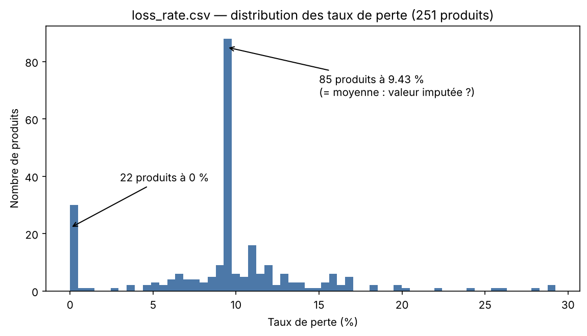

# Étape 1 — Diagnostic de `loss_rate.csv`

**Responsable : collègue** — branche `feature/clean-loss-rate`
Source : `data/raw/loss_rate.csv` · Script de diagnostic rejouable :
`scripts/etape1_diagnostic_loss_rate.py`

## 1. Vue d'ensemble

| Indicateur | Valeur |
|---|---|
| Lignes × colonnes | **251 × 3** |
| Rôle | Dimension : taux de perte (démarque) par produit |
| Valeurs manquantes | **0** |
| Doublons complets de lignes | **0** |
| Clé primaire | `Item Code` — **parfaite** : 251 codes distincts pour 251 lignes |
| Taux de perte | de 0,00 % à 29,25 % ; moyenne et médiane **9,43 %** |

## 2. Dictionnaire des colonnes

| Colonne | Type détecté | Rôle |
|---|---|---|
| `Item Code` | texte (15 chiffres) | **clé primaire**, jointure vers `product` et `transaction` |
| `Item Name` | texte | libellé redondant avec `product.csv` |
| `Loss Rate (%)` | décimal | part de la marchandise perdue (en %) : sert à la marge nette |

## 3. Constats et plan de nettoyage

Chaque décision est justifiée par la logique métier (règle d'or du cours).

| # | Constat chiffré | Décision de nettoyage | Justification métier |
|---|---|---|---|
| 1 | **85 produits (33,9 %) ont exactement 9,43 %**, soit la moyenne de la table ; ils pèsent **16,7 % du CA** (84 sont vendus) | **Conserver** la valeur, la documenter comme limite | Très probablement une valeur **imputée par la moyenne** à la source. La remplacer par autre chose reviendrait à inventer une donnée ; on la garde mais le dashboard ne doit pas présenter ces taux comme mesurés produit par produit |
| 2 | **22 produits à 0,00 %** (tous vendus, **0,3 % du CA**) | **Conserver**, signaler | Un taux de perte de 0 % est improbable pour du frais : plutôt « non mesuré » que « aucune perte ». Part du CA négligeable, on ne remplace pas par une moyenne sans validation métier |
| 3 | **Aucune valeur hors de [0 ; 100]** ; **5 produits au-dessus de 25 %** (max 29,25 %, `High Melon (1)`) | **Conserver** | Taux élevés mais plausibles pour des produits très périssables (jeunes pousses, melon). Une borne arbitraire supprimerait de vraies pertes |
| 4 | **Intégrité parfaite** : 0 code absent de `product`, 0 produit sans taux, les **246 produits vendus** sont tous couverts | Rien à corriger (vérifié) | La jointure `dim_product` ↔ `loss_rate` ne perd aucune ligne |
| 5 | **5 produits jamais vendus** ont un taux | **Conserver** | Cohérent avec `product` : la dimension reste complète même sans fait associé |
| 6 | Colonne **`Item Name` redondante** (4 libellés avec espaces parasites ; noms identiques à `product` sinon) | **Supprimer la colonne** | Le contrat d'équipe n'attend que `Item Code` + `Loss Rate (%)` ; le nom vit dans `product_clean` (une seule source de vérité) |
| 7 | `Item Code` lu comme un **nombre** par défaut | Convertir en **texte** | Clé de jointure, pas une mesure (contrat d'équipe) |
| 8 | 0 valeur manquante, 0 doublon complet, 0 code dupliqué | Rien à corriger (vérifié) | — |

## 4. Le piège principal (à retenir pour la restitution)

La table est **structurellement parfaite** mais **statistiquement trompeuse** :
un tiers des produits partage une même valeur, la moyenne. Une analyse de
« produits à plus forte perte » ou une moyenne par catégorie reposerait pour
partie sur des taux **non mesurés** ; et un taux à 0 % ferait passer certains
produits pour des « sans perte ». Il faut garder ces limites en tête avant de
commenter des écarts de perte entre produits.

## 5. En sortie d'étape 3, la table `loss_rate` propre devra contenir

- colonnes exactes du contrat : `Item Code` (texte), `Loss Rate (%)` ;
- **251 lignes en entrée = 251 lignes en sortie** (aucune suppression) ;
- aucun manquant, taux dans [0 ; 100].

