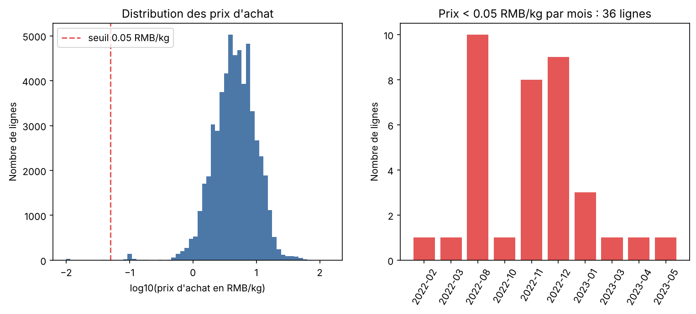

# Étape 1 — Diagnostic de `price.csv`

**Responsable : collègue** — branche `feature/clean-price`
Source : `data/raw/price.csv` · Script de diagnostic rejouable :
`scripts/etape1_diagnostic_price.py`

## 1. Vue d'ensemble

| Indicateur | Valeur |
|---|---|
| Lignes × colonnes | **55 982 × 3** |
| Rôle | Dimension : prix d'achat (wholesale) par produit et par jour |
| Période | 2020-07-01 → 2023-06-30 (1 091 jours distincts sur 1 095) |
| Valeurs manquantes | **0** |
| Doublons complets de lignes | **0** |
| Clé primaire | (`Item Code`, `Date`) — **parfaite** : 0 doublon |
| Produits | 251 (médiane de 91 jours de prix par produit) |

## 2. Dictionnaire des colonnes

| Colonne | Type détecté | Rôle |
|---|---|---|
| `Date` | texte (AAAA-MM-JJ) | jour du prix, moitié de la clé composite |
| `Item Code` | texte (15 chiffres) | moitié de la clé, jointure vers `transaction` et `product` |
| `Wholesale Price (RMB/kg)` | décimal | prix d'achat au kilo : sert à la marge brute |

## 3. Constats et plan de nettoyage

Chaque décision est justifiée par la logique métier (règle d'or du cours).

| # | Constat chiffré | Décision de nettoyage | Justification métier |
|---|---|---|---|
| 1 | **36 prix d'achat < 0,05 RMB/kg** (27 produits, de févr. 2022 à mai 2023, pic en août et nov.-déc. 2022) ; **27 sont exactement à 0,01**. Le prix médian de la table est de 4,63 et ces produits valent 3 à 11 RMB/kg le reste du temps | **Corriger** : remplacer par la médiane des prix valides voisins du même produit (fenêtre de 7 jours centrée, à défaut médiane du produit) | Un légume acheté 0,01 RMB/kg n'existe pas : c'est une saisie ou un placeholder. Laissé tel quel, il gonfle la marge brute de la ligne à ≈ 100 % du CA. On **corrige sans supprimer** : la ligne doit rester jointe aux ventes (115 lignes de vente concernées) |
| 2 | **48 prix > 50 RMB/kg** (10 produits), maximum **141** | **Conserver** | Pics cohérents avec des produits vendus à la pièce/coffret (ex. 141 constant sur `Hongshan Gift Box`, 3 jours consécutifs) ; ce n'est pas une erreur de saisie. À signaler dans la restitution, pas à corriger |
| 3 | Fortes variations d'un jour à l'autre sur certains produits (ex. 112,36 le 2022-05-20 pour `Millet Pepper`, médiane du produit 12,24) | **Conserver**, signaler | Un prix de gros de légume est volatil (saisonnalité, météo). Un seuil automatique « écart à la médiane » supprimerait des vraies variations ; seul l'impossible absolu (< 0,05) est corrigé |
| 4 | **4 jours du calendrier sans aucun prix** (2021-02-11, 2021-02-12, 2022-01-31, 2023-01-21) | **Ne rien inventer** | Aucune vente de ces jours-là n'est privée de prix (voir point 6). Combler le calendrier créerait des lignes de prix fictives |
| 5 | **84 produits avec moins de 30 jours de prix** (certains n'en ont qu'1) | **Conserver** | Produits peu référencés ou vendus en quelques jours : la jointure se fait sur le jour exact de la vente, pas besoin d'historique complet |
| 6 | **Couverture parfaite** : 246/246 produits vendus ont un prix, et **46 599 couples (produit, jour) vendus sur 46 599** trouvent leur prix du jour (100 %) | Rien à corriger (vérifié) | La jointure `fact_sales` ↔ `price` sur (`Item Code`, `Date`) ne perd aucune ligne |
| 7 | `Item Code` lu comme un **nombre** par défaut | Convertir en **texte** | Clé de jointure, pas une mesure (contrat d'équipe) |
| 8 | 0 valeur manquante, 0 doublon complet, 0 doublon (`Item Code`, `Date`), 0 prix ≤ 0 | Rien à corriger (vérifié) | — |

## 4. Le piège principal (à retenir pour la restitution)

Cette table est **propre structurellement** (pas de doublon, pas de trou) :
le piège est **dans les valeurs**. Les prix à 0,01 RMB/kg passent tous les
contrôles « classiques » (pas de manquant, pas de négatif) et ne se voient
qu'en comparant chaque prix à ceux du même produit.

Mesure d'impact, après correction : la marge brute totale passe de
1 243 666 à 1 243 434 RMB (−231 RMB, soit −0,02 %). L'effet est faible sur le
total, mais il n'est pas nul sur une ligne ou un produit isolé : c'est une
correction d'hygiène, pas un changement de conclusion.

## 5. En sortie d'étape 3, la table `price` propre devra contenir

- colonnes exactes du contrat : `Date` (AAAA-MM-JJ), `Item Code` (texte),
  `Wholesale Price (RMB/kg)` ;
- **55 982 lignes en entrée = 55 982 lignes en sortie** (aucune suppression) ;
- aucun doublon (`Item Code`, `Date`), aucun manquant, aucun prix < 0,05.

