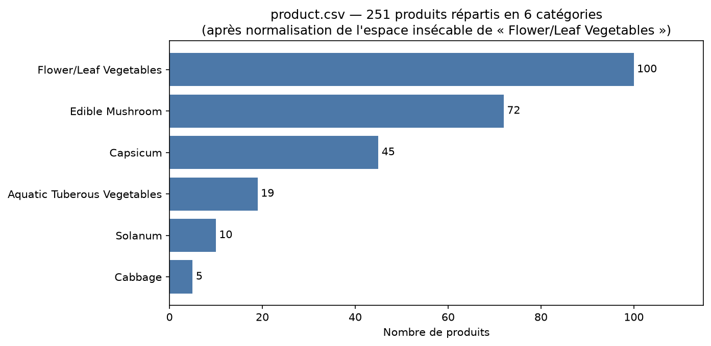

# Étape 1 — Diagnostic de `product.csv`

**Responsable : Lucas** — branche `feature/clean-product`
Source : `data/raw/product.csv` · Script de diagnostic rejouable :
`scripts/etape1_diagnostic_product.py`

## 1. Vue d'ensemble

| Indicateur | Valeur |
|---|---|
| Lignes × colonnes | **251 × 4** |
| Rôle | Référentiel produits (dimension) |
| Valeurs manquantes | **0** |
| Doublons complets de lignes | **0** |
| Clé primaire | `Item Code` — **parfaite** : 251 codes distincts pour 251 lignes |
| Répartition | 6 catégories : Flower/Leaf Vegetables (100), Edible Mushroom (72), Capsicum (45), Aquatic Tuberous Vegetables (19), Solanum (10), Cabbage (5) |

C'est la petite table de dimension qui sera jointe aux 878 503 ventes de
`transaction.csv` sur `Item Code` (0 orphelin des deux côtés : jointure sûre).

## 2. Dictionnaire des colonnes

| Colonne | Type détecté | Rôle |
|---|---|---|
| `Item Code` | entier (15 chiffres) | **clé primaire**, jointure vers `transaction` |
| `Item Name` | texte | libellé produit (affichage dashboard) |
| `Category Code` | entier (10 chiffres) | code catégorie |
| `Category Name` | texte | libellé catégorie (filtre dashboard) |

## 3. Constats et plan de nettoyage

Chaque décision est justifiée par la logique métier (règle d'or du cours).

| # | Constat chiffré | Décision de nettoyage | Justification métier |
|---|---|---|---|
| 1 | **Espace insécable invisible** : la catégorie `'Flower/Leaf\xa0Vegetables'` contient un caractère `\xa0` sur ses **100 lignes** | Remplacer `\xa0` par un espace normal (`str.replace`) | Ce caractère est **invisible à l'œil nu** : sans correction, la catégorie apparaîtrait en **2 valeurs distinctes** dans les filtres du dashboard et fausserait l'analyse par catégorie — précisément la demande du Comex |
| 2 | **4 noms de produits avec espaces parasites** en début/fin (« Foreign Garland Chrysanthemum␣ », « Yuxingcao␣ », « Powcan Mountain Chinese Cabbage␣ », « Hericium␣ ») | `str.strip()` sur `Item Name` | Évite des doublons de libellés dans les listes déroulantes du dashboard |
| 3 | **4 noms portés par 2 codes différents** : 2× « Apricot Bao Mushroom (Bag) », 2× « Chinese Cabbage » (même catégorie), 2× « Chinese Caterpillar Fungus Flowers (Bag) », et 2× « Broccoli » — l'un en *Flower/Leaf Vegetables*, l'autre en *Cabbage* | **Conserver** : `Item Code` reste la clé, les doublons de noms sont des produits réellement distincts | Le « Broccoli » de la famille choux et celui de la famille feuilles ne sont pas le même article (calibre/fournisseur différents) ; fusionner par nom casserait les jointures et mélangerait les marges |
| 4 | `Item Code` et `Category Code` lus comme des **nombres** | Convertir en **texte** | Ce sont des identifiants de jointure, pas des mesures : on ne calcule pas dessus |
| 5 | Mapping `Category Code` ↔ `Category Name` **1:1 parfait** (6 codes, 6 noms, aucune incohérence) | Rien à corriger — indexer les deux colonnes en catégoriel | Le filtre par catégorie du dashboard sera fiable après normalisation du point 1 |
| 6 | **5 produits jamais vendus** sur 3 ans (aucune ligne de vente associée) | **Conserver** dans la dimension | Une dimension reste complète même sans fait associé : ces produits pourront être vendus plus tard, et la clé `Item Code` ne doit pas « bouger » entre deux extractions |
| 7 | 0 valeur manquante, 0 doublon complet, 251/251 codes uniques | Rien à corriger (vérifié) | — |

## 4. Le piège principal (à retenir pour la restitution)

L'anomalie la plus importante de cette table est **invisible** : l'espace
insécable `\xa0`. Preuve (sortie du script de diagnostic) :

```python
sorted(df["Category Name"].unique())
# ['Aquatic Tuberous Vegetables', 'Cabbage', 'Capsicum',
#  'Edible Mushroom', 'Flower/Leaf\xa0Vegetables', 'Solanum']
```

Sans nettoyage, un `df.groupby("Category Name")` produirait 6 catégories
dont une dupliquée à l'affichage. C'est exactement le type de « biais majeur
dans des données brutes » que le cours demande de challenger (Exercice 1).

## 5. En sortie d'étape 3, la table `product` propre devra contenir

- `Item Code`, `Category Code` en texte (clés de jointure) ;
- `Item Name` nettoyé (trim) ;
- `Category Name` normalisé : `\xa0` → espace, puis trim ;
- **251 lignes en entrée = 251 lignes en sortie** (aucune suppression).


