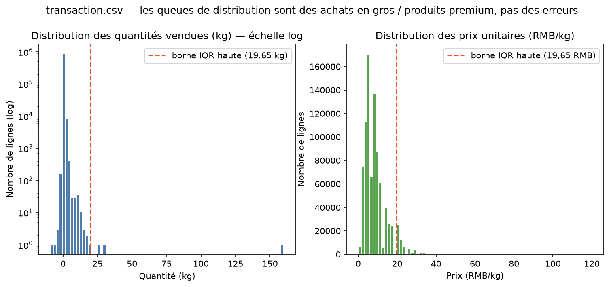

# Étape 1 — Diagnostic de `transaction.csv`

**Responsable : Lucas** — branche `feature/clean-transaction`
Source : `data/raw/transaction.csv` · Script de diagnostic rejouable :
`scripts/etape1_diagnostic_transaction.py`

## 1. Vue d'ensemble

| Indicateur | Valeur |
|---|---|
| Lignes × colonnes | **878 503 × 7** |
| Période couverte | **01/07/2020 → 30/06/2023** (3 ans, 1 085 jours) |
| Produits distincts vendus | 246 |
| Valeurs manquantes | **0** |
| Doublons complets de lignes | **0** |
| CA net sur la période (qté × prix) | ≈ 3,37 M RMB (≈ 1,15 M RMB sur les 12 derniers mois) |

Contexte : tickets de caisse d'un marché de gros de légumes (Chine) —
poids en kg, prix en RMB/kg. 285 030 lignes concernent les 12 derniers mois
(juin 2022 → juin 2023), la période demandée par le Comex.

## 2. Dictionnaire des colonnes

| Colonne | Type détecté | Rôle |
|---|---|---|
| `Date` | texte (ISO `YYYY-MM-DD`) | date de la vente |
| `Time` | texte (`HH:MM:SS.mmm` ou `HH:MM:SS`) | heure de la vente |
| `Item Code` | entier (15 chiffres) | **clé étrangère vers `product`** |
| `Quantity Sold (kilo)` | décimal | poids vendu ; **négatif = retour** |
| `Unit Selling Price (RMB/kg)` | décimal | prix appliqué à la transaction |
| `Sale or Return` | texte (`sale` / `return`) | nature de la ligne |
| `Discount (Yes/No)` | texte (`Yes` / `No`) | remise appliquée |

## 3. Constats et plan de nettoyage

Chaque décision est justifiée par la logique métier (règle d'or du cours).

| # | Constat chiffré | Décision de nettoyage | Justification métier |
|---|---|---|---|
| 1 | `Date` est du texte (0 date invalide après conversion) | Convertir en `datetime` | Indispensable pour filtrer juin 2022 → juin 2023, comparer N-1 et agréger par mois dans le dashboard |
| 2 | `Time` présente **2 formats** : 878 371 lignes avec millisecondes, **132 sans** (`13:03:52`) | Parser avec `format="mixed"` (aucune ligne perdue) | Ce sont des heures valides, juste un format différent : les supprimer déformerait le CA de 132 transactions |
| 3 | `Item Code` est lu comme un **nombre** (15 chiffres) | Convertir en **texte** | Un code produit est un identifiant de jointure, pas une mesure : on ne calcule pas dessus, et le texte évite toute perte de zéro non significatif lors des fusions |
| 4 | **461 retours** portent exactement les 461 quantités négatives (cohérence 100 %, max -9,082 kg) | **Ne pas supprimer** : conserver les lignes + colonne binaire `is_return` | Le dictionnaire de données du cours définit la quantité vendue **sans les retours** : ils seront exclus des KPI à l'agrégation, mais les garder en base préserve le CA net et l'analyse des pertes |
| 5 | 10 868 lignes (1,2 %) au-delà de la borne IQR haute (1,42 kg), max **160 kg** | **Ne pas supprimer** : achats en vrac légitimes, marqués `is_bulk` (optionnel) | Marché de **gros** : les grandes quantités sont des clients professionnels (restaurants, revendeurs). Les supprimer sous-estimerait le CA de manière arbitraire |
| 6 | 61 880 lignes (7 %) au-dessus de la borne IQR globale de prix (19,65 RMB/kg), max 119,90 | **Ne pas supprimer** : l'IQR global n'a pas de sens ici | 218/246 produits ont plusieurs prix dans le temps ; 119,90 RMB/kg correspond à des produits premium (champignons rares). Une anomalie de prix se juge **par produit**, pas globalement |
| 7 | `Sale or Return` et `Discount` : exactement 2 modalités propres, aucune faute de frappe | Standardiser en catégoriel (`sale`/`return`, `Yes`/`No`) | Évite tout doublon de modalité dans les filtres du dashboard |
| 8 | Intégrité référentielle : **0 vente orpheline** (tout `Item Code` vendu existe dans `product.csv`) ; 5 produits jamais vendus côté référentiel | Rien à corriger ; la jointure est sûre | La consolidation ne perdra aucune ligne de vente |
| 9 | Amplitude horaire 08:14 → 23:11, presque tout entre 9h et 22h | Aucune correction (heures plausibles d'un marché de gros) | Pas de vente nocturne aberrante : pas de raison de découper |
| 10 | Le besoin métier cible les **12 derniers mois**, la table en couvre 36 | **Garder les 3 ans** dans la table de faits ; filtrer 07/2022 → 06/2023 au niveau du dashboard | Garder l'historique permet la comparaison N-1 (évolution vs N-1 = KPI demandé) ; le filtre est une question de restitution, pas de nettoyage |

## 4. Points déjà propres (vérifiés, rien à faire)

- Aucune valeur manquante, aucun doublon complet.
- Dates toutes interprétables (0 rejet).
- Prix et quantités strictement cohérents avec la colonne `Sale or Return`.
- 47 366 lignes avec remise (5,4 %) : cohérent avec un marché qui négocie.

## 5. En sortie d'étape 3, la table `transaction` propre devra contenir

- `Date` en datetime, `Time` parsée en un format unique ;
- `Item Code` en texte (clé de jointure) ;
- `Quantity Sold (kilo)`, `Unit Selling Price (RMB/kg)` conservés tels quels ;
- colonnes dérivées : `is_return` (binaire), `sales_amount` = qté × prix
  (le CA de la ligne, négatif pour un retour) ;
- **aucune ligne supprimée** — 878 503 en entrée = 878 503 en sortie.

