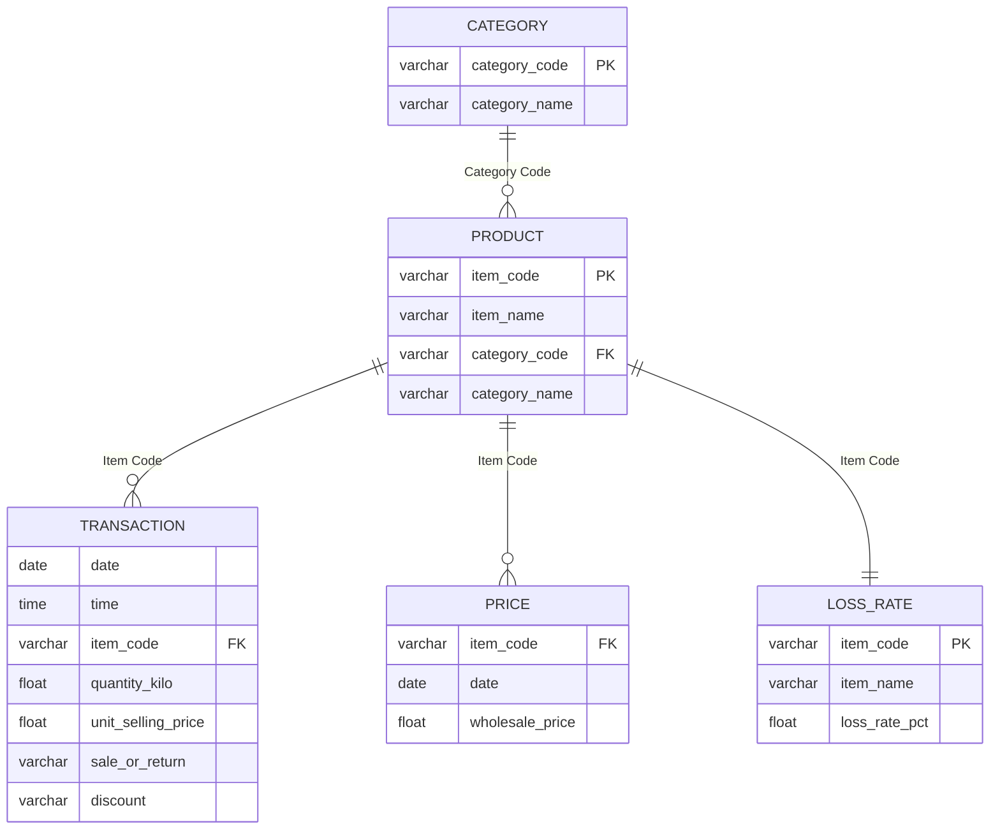
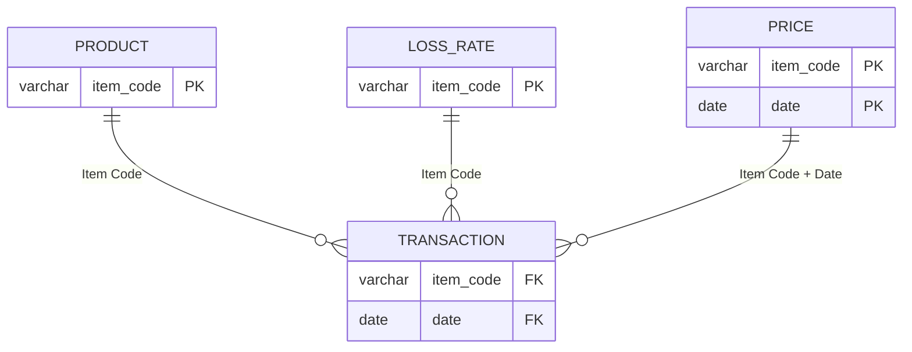
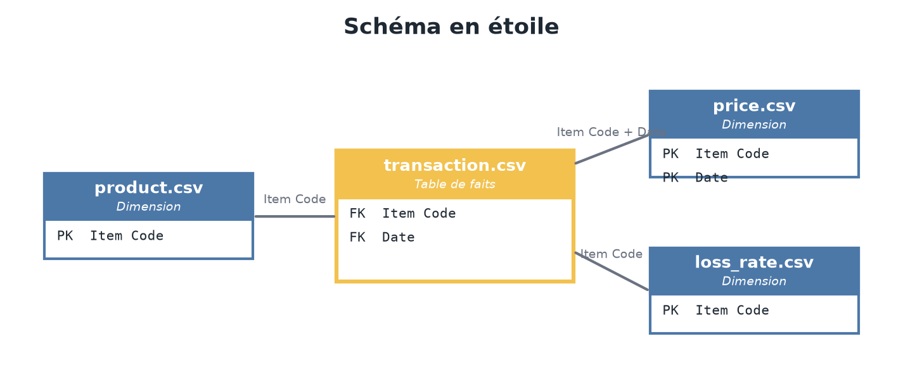

# Étape 2 — Modèle de données cible & schéma en étoile

> Conçu collectivement à partir des diagnostics de l'étape 1, **avant** la
> consolidation (ordre du cours : le modèle d'abord, le code ensuite).

## 1. Modèle relationnel (tables brutes et liaisons)

Les 4 tables brutes et leurs liaisons autour de la clé commune **`Item Code`** :

| Table brute | Lignes | Clé | Rôle |
|---|---|---|---|
| `transaction` | 878 503 | pas de PK naturelle (1 ligne = 1 ligne de caisse) | Faits : ventes et retours au poids et au prix unitaire |
| `product` | 251 | PK `Item Code` | Référentiel : nom du produit + catégorie |
| `price` | 55 982 | PK composite (`Item Code`, `Date`) | Prix d'achat (wholesale) par produit et par jour |
| `loss_rate` | 251 | PK `Item Code` | Taux de perte / démarque par produit |

Vérifications d'intégrité faites au diagnostic (étape 1) :

- `transaction.Item Code` → `product.Item Code` : **0 orphelin**, jointure sûre ;
- `product` : 251 codes uniques (clé primaire parfaite) ;
- 5 produits du référentiel jamais vendus (ils resteront dans la dimension).

## 2. Schéma en étoile (les 4 CSV)

**Table de faits centrale : `transaction.csv`** (grain : 1 ligne = 1 ligne de
caisse). Les 3 autres CSV l'entourent en **dimensions** :

| Table | Rôle | Clé |
|---|---|---|
| `transaction.csv` | **Table de faits** | FK `Item Code`, FK `Date` |
| `product.csv` | Dimension | PK `Item Code` |
| `price.csv` | Dimension | PK composite (`Item Code`, `Date`) |
| `loss_rate.csv` | Dimension | PK `Item Code` |

Liaisons :

- `transaction` → `product` et `loss_rate` : par `Item Code` ;
- `transaction` → `price` : par (`Item Code`, `Date`) — 218/246 produits
  changent de prix d'achat dans le temps, d'où la clé composite ;
- les **mesures** (quantité, prix, CA) restent dans la table de faits, les
  **attributs descriptifs** (noms, catégories, taux de perte) restent dans
  les dimensions, dédupliqués : 251 lignes de `product` au lieu de 878 503.

## 3. Contraintes de qualité imposées au pipeline (issues du diagnostic)

| Contrainte | Origine (diagnostic) |
|---|---|
| Les `\xa0` de `Category Name` normalisés en espaces | sinon la catégorie « Flower/Leaf Vegetables » apparaît en double dans les filtres |
| `Item Code` traité en **texte** dans toutes les tables | c'est une clé de jointure, pas une mesure |
| Les 461 retours **conservés** et marqués `is_return` | le KPI « quantité vendue » du dictionnaire exclut les retours ; les garder préserve le CA net |
| 878 503 lignes en entrée = 878 503 en sortie | aucune suppression : les « outliers » sont des achats en gros légitimes |
| Heures parsées en un format unique (`format="mixed"`) | 132 lignes sans millisecondes à ne pas perdre |

## 4. Règles de nommage des sorties (contrat d'équipe)

Pour que les branches feature de chacun s'assemblent sans friction dans
`develop`, chaque responsable produit sa table nettoyée dans `data/clean/` :

| Responsable | Fichier attendu | Colonnes clés |
|---|---|---|
| Lucas | `transaction_clean.csv` | `Date`, `Time`, `Item Code`, `Quantity Sold (kilo)`, `Unit Selling Price (RMB/kg)`, `Sale or Return`, `Discount (Yes/No)`, `is_return`, `sales_amount`, `hour` |
| Lucas | `product_clean.csv` | `Item Code`, `Item Name`, `Category Code`, `Category Name` |
| _[collègue]_ | `price_clean.csv` | `Date`, `Item Code`, `Wholesale Price (RMB/kg)` |
| _[collègue]_ | `loss_rate_clean.csv` | `Item Code`, `Loss Rate (%)` |

Le script `scripts/etape3_consolidate.py` assemble ensuite la table de faits
et les dimensions selon le schéma ci-dessus.
